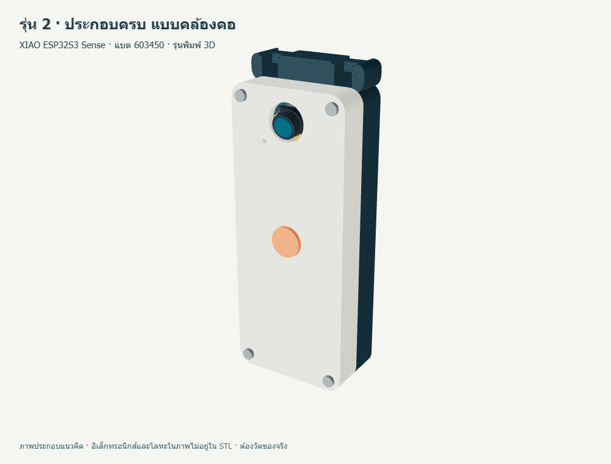
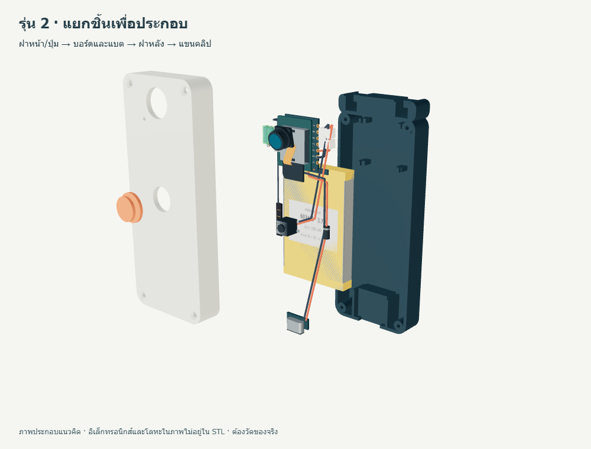
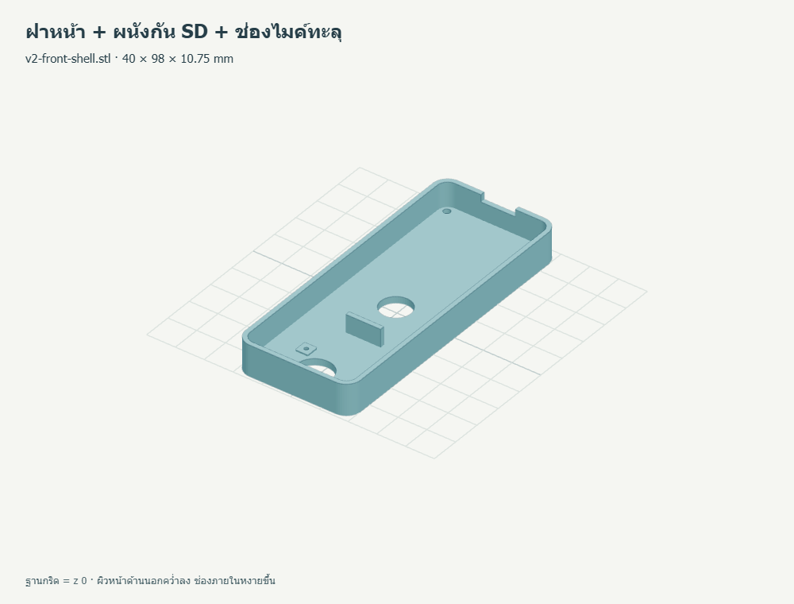
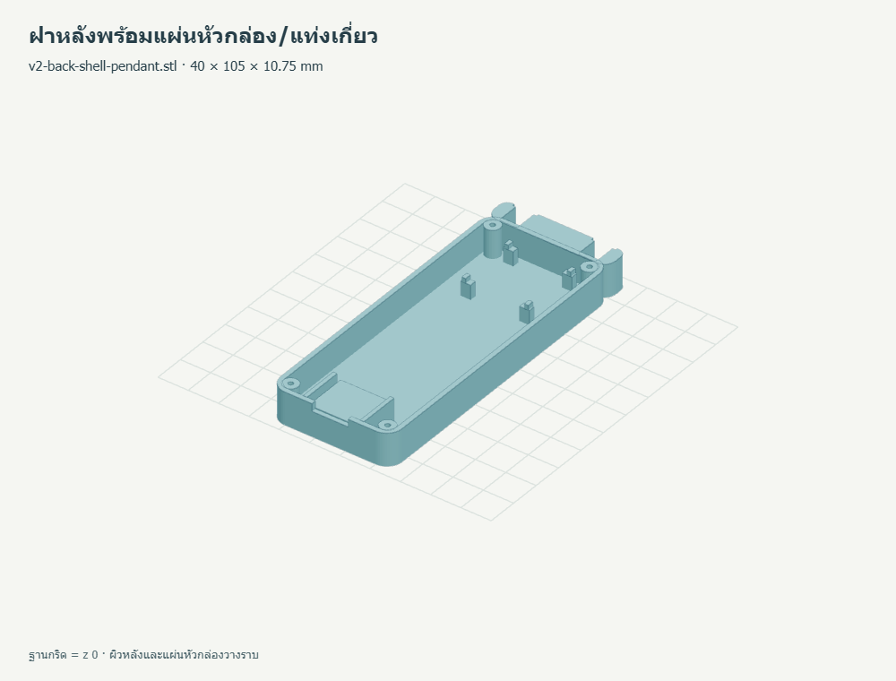
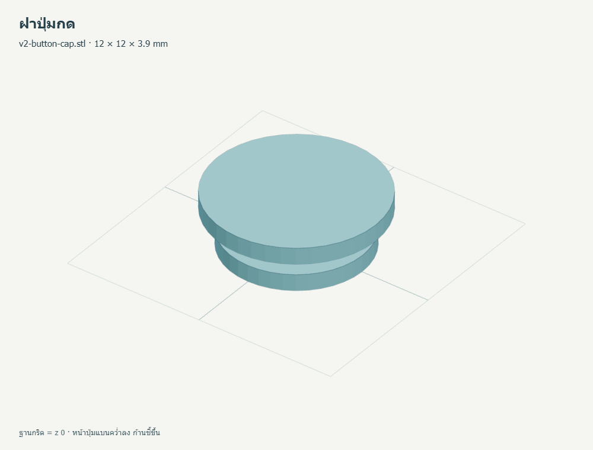
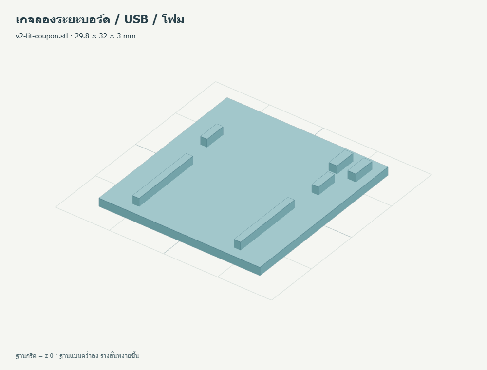
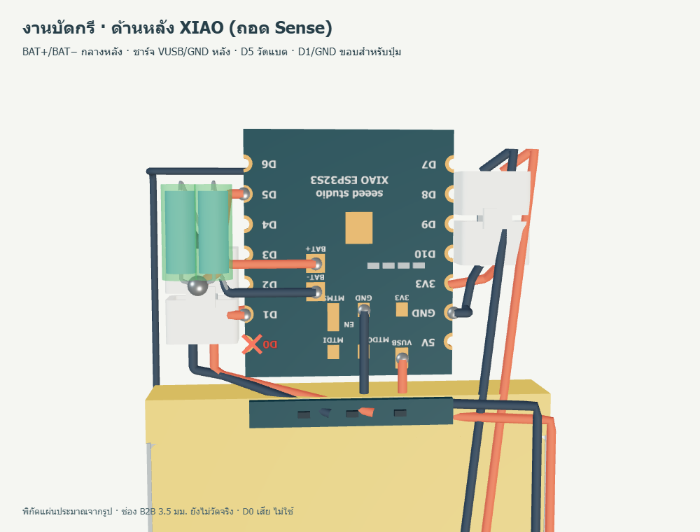

# Memory Clip v2 - Pendant Print Package

Open [offline print handout](index.html) and print A4 at 100% / disable browser headers-footers.

## ชุดส่งพิมพ์รอบนี้ · แบบคล้องคอ

ส่งออกเฉพาะ 4 STL: ฝาหน้า, ฝาหลัง pendant พร้อมแผ่นหัวกล่องสองช่อง, ฝาปุ่ม และ fit coupon. แบบคลิป/แม่เหล็กยัง build ได้ แต่ไม่รวมในชุดพิมพ์รอบนี้.

กล่องหลัก กว้าง × สูง × หนา: 40 × 98 × 21.5 มม.; ขนาดฝาหลังรวมแผ่นหัว 40 × 105 × 10.75 มม. (ดูกรอบจริงรายชิ้นใน manifest)

ช่องและแท่งเกี่ยว: x=±13 มม.; ช่อง 6×4.5 มม. R1, แท่งกว้าง 3 มม. หนา 5 มม. เว้าจากขอบ 0.8 มม. สอดปลายตะขอเข้าช่อง แล้วคล้องรอบแท่ง.

ใช้สกรู M2 หัวเตเปอร์ 90° ยาว 16 มม.; ระยะปลายถึงผิวหลังตามแบบ 5.5 มม. รูฝาหน้า Ø4.0/Ø2.4 มม. รูนำเสา Ø1.7 มม.

ช่อง breakout ภายใน 16×14 มม. ไม่มีผนังหลัง; ช่องสาย USB 12×5 มม. จัดหัว USB ให้ตรงช่องก่อนหยอดกาวร้อน. EVA ตั้งไว้ 2 มม. และรอวัดความหนาจริง; ด้านหลังเรียบ ไม่มีร่อง ติดแผ่นยางกันลื่นขนาดประมาณ 30×50 มม. บนผิวหลังตรงแบต

วัดแล้ว 23 ต.ค.: XIAO 17.1×20.8 มม. (ใช้ 17.8×21), stack 13.0 มม. (ใช้ 13.5), ปุ่มสูง 7.1 มม. และเลนส์ Ø8.0. ยังรอวัด USB breakout, สกรู และความหนาโฟมจริง. PLA ในตารางคำนวณจากเนื้อตัน 100%; ค่าจริงขึ้นกับ infill, wall, support และ slicer.

dfam-check (Claude รันด้วย .venv-dfam, 23 ต.ค.): STL ทั้ง 4 ไฟล์ปิดสนิท (watertight) ผนัง p05 ≥ 1.2 มม. ยกเว้นขอบนูนรอบรูไมค์ด้านในฝาหน้าสูง 0.6 มม. (3 ชั้นที่ 0.2 มม.) ซึ่งไม่ใช่ผนัง ทิศวางพิมพ์: ฝาหน้าและฝาหลังวางด้านนอกลงฐานตามไฟล์ ไม่ต้องหมุน

## เอกสารคุยกับเจ้าหน้าที่คณะ

Memory Clip เป็นกล้องติดหน้าอกสำหรับบันทึกภาพอัตโนมัติทุก 1 นาที ใช้บอร์ด XIAO ESP32S3 Sense พร้อมกล้องและ microSD กับแบต LiPo 603450 (เลือก 1000 ในแบบ: 34 × 50 × 6 มม.) ชุดนี้เป็นกล่องพิมพ์ 3D รุ่น 2 สำหรับทดลองประกอบกับฮาร์ดแวร์จริง

สถานะ: ไฟล์ STL พร้อมนำเข้า slicer แต่ยังไม่ผ่านการวัดชิ้นส่วนและทดลองพิมพ์จริง ขนาด 603450 เป็นขนาดนามบัญญัติ ไม่ใช่ผลวัดซองแบตที่รวมแท็บ สาย และวงจรป้องกัน

### เลือกเพียงหนึ่งรูปแบบการยึด

- คลิป: ฝาหน้า + ฝาหลัง clip + ฝาปุ่ม + mount-clip พร้อมสลักและสปริงโลหะ
- แม่เหล็ก: ฝาหน้า + ฝาหลัง magnet + ฝาปุ่ม + mount-magnet พร้อมแม่เหล็ก 10 × 3 มม. 4 ก้อน
- คล้องคอ (pendant): ฝาหน้า + ฝาหลัง pendant + ฝาปุ่ม แผ่นหัวกล่องพร้อมแท่งเกี่ยวรวมในฝาหลัง ไม่มีชิ้น mount แยก

เริ่มจาก v2-fit-coupon.stl ก่อน จากนั้นวัดขนาดและทดลองประกอบโดยไม่ฝืนขอบ PCB หรือกดซองแบต ไฟล์ทุกชิ้นใช้มิลลิเมตร; ตั้ง scale 100% และปิดการย่อให้พอดีฐานอัตโนมัติ

## รายการไฟล์และประมาณการพิมพ์

| ไฟล์ / ชิ้นส่วน | กรอบ X×Y×Z (มม.) | ปริมาตร cm³ | PLA g* | นาที* |
| --- | --- | --- | --- | --- |
| [v2-front-shell.stl](v2-front-shell.stl) ฝาหน้า + ผนังกัน SD + ช่องไมค์ทะลุ | 40 × 98 × 10.75 | 11.54 | 14.31 | 44–112 |
| [v2-back-shell-pendant.stl](v2-back-shell-pendant.stl) ฝาหลังพร้อมแผ่นหัวกล่อง/แท่งเกี่ยว | 40 × 105 × 10.75 | 14.85 | 18.41 | 55–139 |
| [v2-button-cap.stl](v2-button-cap.stl) ฝาปุ่มกด | 12 × 12 × 3.9 | 0.25 | 0.31 | 6–18 |
| [v2-fit-coupon.stl](v2-fit-coupon.stl) เกจลองระยะบอร์ด / USB / โฟม | 29.8 × 32 × 3 | 1.51 | 1.87 | 9–18 |

* ปริมาตรเป็นผลรวมของ solid ปิดแต่ละชิ้นก่อน union จึงนับส่วนซ้อนซ้ำ มวล = ปริมาตร × 1.24 g/cm³ สมมติเนื้อตัน 100% เป็นค่าประเมินด้านสูงของตัวโมเดล ไม่รวม support, brim หรือของเสีย ไม่ใช่มวลจาก infill 20% และไม่ควรคูณตัวเลขนี้ด้วย 0.2 เพราะผนังบางพิมพ์เกือบตัน

เวลาเป็นประมาณการเชิงวางแผน: หัวฉีด 0.4 มม., ชั้น 0.2 มม., อัตราเนื้อพลาสติกเฉลี่ยรวม travel 2–5 mm³/s ใช้ปริมาตรตันข้างต้น + 5–15 นาทีต่อชิ้น (coupon + 3–5 นาที); ชิ้นที่ระบุ support แน่นอนเผื่อเวลา 30% ยังไม่ใช่ผล slice เครื่องจริง เครื่องช้าหรือ support มากอาจเกินช่วงนี้

### สิ่งที่อยู่ใน STL

ฝาหน้ารวม shell, เสา M2, ผนังกัน SD และท่อไมค์ ฝาหลังทุกแบบรวม shell, เสา M2, ขารองบอร์ด 4 จุดพร้อม lip 4 จุด และฐาน/ผนังข้าง 2 ชิ้น/stop ของ USB cradle พร้อมหูบานพับ วงแหวนแม่เหล็ก หรือแผ่นหัวกล่องพร้อมแท่งเกี่ยวตามแบบ ไม่มีโฟม ไดโอด PCB breakout สาย แม่เหล็ก สกรู สปริง หรือสลักโลหะใน STL

วิธีรวม: เก็บเป็น closed shells หลายชิ้นที่ซ้อนหรือแตะกันภายใน STL เดียว ไม่ได้ทำ boolean union ใน Node ให้นำเข้าแต่ละ STL เป็นวัตถุเดียว และเปิดการรวมเนื้อซ้อนใน PrusaSlicer / Cura / Bambu Studio ห้ามแยกเป็นวัตถุแล้วจัดวางอัตโนมัติ ตรวจ layer preview ว่าเนื้อเสา ขารอง lip และ cradle ต่อกับฝาจริง โดยเฉพาะรอยสัมผัสที่ไม่มีระยะซ้อน ถ้าไม่รวมให้ใช้ union/repair ใน slicer ก่อนพิมพ์

## ทิศวางพิมพ์และ support 1/2

ผิวหน้าด้านนอกคว่ำลง ช่องภายในหงายขึ้น

Support: ไม่; ตรวจสะพานสั้นเหนือช่อง USB ใน slicer

Brim: ไม่จำเป็นบนฐานที่ยึดเกาะดี

ผิวหลังและแผ่นหัวกล่องวางราบ

Support: ไม่; ตรวจสะพานสั้นเหนือช่อง USB

Brim: ไม่จำเป็นบนฐานที่ยึดเกาะดี

หน้าปุ่มแบนคว่ำลง ก้านชี้ขึ้น

Support: ไม่; ยื่นจากฐานแบน

Brim: ไม่จำเป็นบนฐานที่ยึดเกาะดี

ฐานแบนคว่ำลง รางสั้นหงายขึ้น

Support: ไม่

Brim: ไม่จำเป็นบนฐานที่ยึดเกาะดี

ทุกชิ้นวางต่ำสุด z=0 และกึ่งกลาง XY=0 แล้ว กริดในภาพคือฐานพิมพ์ ระยะทั้งหมดไม่เกินฐาน 180 × 180 × 180 มม. ฝาหลัง clip วางบนผนังยาวเพราะหูบานพับยื่นออกจากผิวหลัง; ช่วยเลี่ยงการรองรับผิวหลังทั้งแผ่น แต่ยังต้อง support ส่วนยื่นภายใน

## ทิศวางพิมพ์และ support 2/2

ทุกชิ้นวางต่ำสุด z=0 และกึ่งกลาง XY=0 แล้ว กริดในภาพคือฐานพิมพ์ ระยะทั้งหมดไม่เกินฐาน 180 × 180 × 180 มม. ฝาหลัง clip วางบนผนังยาวเพราะหูบานพับยื่นออกจากผิวหลัง; ช่วยเลี่ยงการรองรับผิวหลังทั้งแผ่น แต่ยังต้อง support ส่วนยื่นภายใน

## ค่าพิมพ์และระยะสวมที่มีอยู่ในแบบ

วัสดุ: เริ่มด้วย PLA เพื่อทดสอบขนาด หากใส่ใช้งานกลางแดดหรือในอากาศร้อนให้พิจารณา PETG เพราะทนความร้อนและเหนียวกว่า PLA; ต้องทดสอบความแข็งแรงของคลิปและการเสียรูปในสภาพใช้งานจริง เลือกอุณหภูมิจากโปรไฟล์เครื่อง/เส้นของคณะ

| ค่าเริ่มต้น | ข้อเสนอ |
| --- | --- |
| Nozzle / layer | 0.4 / 0.2 มม. |
| Walls / top / bottom | อย่างน้อย 3 perimeters; top/bottom 4–5 ชั้น |
| Infill | 20% gyroid สำหรับฝา; 40% สำหรับแขนคลิป; coupon 20% (รางและผนังเล็กมักตัน) |
| Supports / brim | ตามภาพหน้า 3–4; ใช้ support แบบ paint-on เฉพาะจำเป็นและแกะได้ ไม่อุดรูสวม |
| Thin features | ใช้ variable line width / thin-wall handling; lip 1.2 มม., ผนังท่อไมค์ 1.45 มม. (≥1.2), ก้นแม่เหล็ก 0.5 มม., หูบานพับฝาหลังหนาตามแกน 1 มม. ต้องเห็นใน layer preview |

| ระยะจาก CONFIG (มม.) | ลักษณะรอยต่อ |
| --- | --- |
| case.wall=1.5; front boss wall=1.3; rear boss wall=1.65 | ผนังโครงสร้าง ≥1.2; ฝาสองซีกชนระนาบ ไม่มีลิ้นล็อกหรือซีล |
| case.screwHole=Ø2.4; bossPilot=Ø1.7; screw.diameter=2 | รูผ่านหลวม +0.4 ทางเส้นผ่านศูนย์กลาง; รูนำแน่นกว่า M2 อยู่ 0.3 ต้องลองเกลียว/แรงขัน |
| v2.ledge.lipGap=0.8/ข้าง; under=0.8; lip=1.2 | บอร์ดสวมหลวมเล็กน้อย +1.6 รวม ไม่ใช่ snap-fit; รองใต้ขอบ 0.8 |
| v2.cradle.sideGap=0.8/ข้าง; stopGap=0.2 | breakout หลวม +1.6 รวม; ด้านหลังเผื่อ 0.2 ไม่ควรฝืน |
| button.holeClearance=0.45; capDiameter=10 | รูปุ่ม Ø10.45: หลวม 0.225 ต่อข้าง ต้องเลื่อนได้หลังลบคม |
| magnet.pocketClearance=0.25 | ช่อง Ø10.25 สำหรับ Ø10: หลวม 0.125 ต่อข้าง ต้องยึดด้วยกาว/เทป |
| clip.pinDiameter=1.8 | รูและสลักใช้ค่าเดียวกัน: ระยะเผื่อ 0 แน่น ต้องลองสลัก/รีมรู |
| v2.sdStop.foam=2; thickness=1.5 | โฟมแตะขอบการ์ดตามแบบ ยังไม่เผื่อการยุบ ต้องไม่ดันการ์ดหรือทำให้ PCB โก่ง |
| case.sideService=4; endClearance=2; bayGap=4; usbBay=16 | พื้นที่เผื่อด้านข้าง/ปลาย/ระหว่างแบตกับบอร์ด/ช่อง USB |
| case.depthClearance=2; tiltReserve=3; battery.rearClearance=1.6 | เผื่อความหนา/มุมกล้อง/หลังแบต ไม่ใช่ระยะสวมทุกจุด |
| case.bossOverlap=0.15 | ระยะซ้อนเพื่อเชื่อม printed solids ไม่ใช่ tolerance สวม |

แหล่งอ้างอิงวัสดุ: Prusa Filament Material Guide และ PETG Knowledge Base (ลิงก์ท้ายเอกสาร). ค่าด้านบนเป็นจุดเริ่มต้นสำหรับคณะปรับใน slicer

## ชิ้นส่วนที่ไม่พิมพ์และลำดับประกอบ

| ชิ้นส่วน | จำนวน / หน้าที่ |
| --- | --- |
| XIAO ESP32S3 Sense + กล้อง + microSD | 1 ชุด; ถ่ายภาพ/เก็บไฟล์; ขอบบอร์ดวางบน ledge ไม่ขันสกรูทะลุ PCB |
| LiPo 603450 + JST / สาย | 1 ชุด; แบต 1000 setting; ต้องรวมซอง แท็บ และวงจรป้องกันในการวัด |
| USB-C breakout มีตัวต้านทาน 5.1 kΩ | 1 ชิ้น; พอร์ตชาร์จแยก รับแรงเสียบผ่าน cradle; ตรวจว่า CC1/CC2 มี Rd ตามบอร์ดจริง |
| 1N5817 (DO-41) | 1 ตัว; ในวงจรตามแบบอยู่อนุกรมสาย 5V จาก breakout ขีด cathode หันไปทาง XIAO; ให้ผู้ดูแลตรวจวงจรจริง |
| สกรู M2 × 16 มม. | 4 ตัว; ยึดฝา รูหัวตามแบบ Ø3.8 × 1.2; ความยาว 20 มม. เป็นค่าลอง ต้องวัดก่อนเลือกซื้อและอย่าให้ปลายทะลุ |
| แม่เหล็ก Ø10 × 3 มม. | 4 ก้อนเฉพาะแบบ magnet: 2 ในฝา + 2 ในแผ่นหลังเสื้อ ตรวจขั้วก่อนยึด |
| เทปโฟมหนา 1 มม. | ติดหน้าผนังกัน SD; ตัดตามปลายการ์ดและทดสอบแรงกด |
| สลัก Ø1.8 × 16 มม. + สปริงบิดโลหะ | แบบ clip อย่างละ 1; สปริง/สลักไม่พิมพ์; วิธีล็อกหัวท้ายสลักต้องตกลงกับคณะ |
| ปุ่ม tactile 6 × 6 + JST / เสาอากาศ U.FL | ตามชุดจริง; เทปยึดและจัดสายไม่ให้ชนฝา |
| สายไฟ, 100kΩ ×2, ท่อหด, กาว/เทป | ตามงานบัดกรีเดิม; ยึดแบต บอร์ด และ breakout โดยไม่ให้กาวเข้าพอร์ต; สายคล้องสำหรับ pendant |

### ลำดับประกอบ (ดูภาพแยกชิ้นหน้าแรก)

1. วัดของจริงและพิมพ์ coupon; ทดลองรูสกรู/สลักบนชิ้นทดสอบเพิ่มถ้าจำเป็น ก่อนพิมพ์ฝาเต็ม
2. Slice และตรวจทุกชั้นว่ารอยซ้อนรวมเป็นเนื้อเดียว พิมพ์ ถอด support ลบคม ตรวจรูและผนังบาง
3. วาง breakout ใน cradle ทดสอบแรงเสียบกับฝา รองขอบบอร์ดบน ledge 4 จุด ตรวจ lip และทางเดินสาย ไม่บังคับกด PCB
4. ติดแบตโดยไม่บีบซอง จัด JST/สาย/ไดโอดและเสาอากาศให้พ้นเสาและขอบฝา ให้ผู้ดูแลตรวจวงจรก่อนต่อแบต
5. ใส่ฝาปุ่มจากด้านในฝาหน้าโดยลอง flange/รูจริง ติดโฟมกัน SD ตรวจการ์ดเสียบสุด กดปุ่มและตรวจเลนส์/ไมค์ไม่บัง
6. ประกบฝาและขัน M2 สลับมุมเบา ๆ ตรวจช่อง USB และไม่มีแรงกดแบต; clip ใส่สลัก/สปริง, magnet ยึด 4 ก้อนตามขั้ว, pendant ร้อยสาย
7. ทดสอบถ่ายภาพทุกนาที การกดปุ่ม การชาร์จ และการยึดเสื้อบนโต๊ะก่อนสวมใส่ เก็บผลขนาด/น้ำหนัก/เวลาเพื่อแก้ CONFIG

## ต้องวัดของจริงก่อนพิมพ์

ทุกมิติฮาร์ดแวร์ด้านล่างยังเป็นค่าประมาณหรือขนาดนามบัญญัติจากแบบ ไม่มีชุดใดในรุ่น 2 ที่ยืนยันว่าใช้เวอร์เนียร์วัดแล้ว ให้บันทึกค่าจริงและวันที่; ภาคผนวกแสดงทุกพารามิเตอร์ของรุ่น 2 ที่ต้องเทียบหรือตัดสินใจ ส่วนสี/มุมมอง/น้ำหนัก/รุ่นกระดาษไม่ใช่มิติพิมพ์

| รายการตรวจ | เครื่องมือและสิ่งที่วัด | ตำแหน่งใน work/config.js |
| --- | --- | --- |
| □ XIAO และ Sense | เวอร์เนียร์: กว้าง/ยาว/PCB, ขอบ/อุปกรณ์ใต้บอร์ด; depth gauge: stack รวมและตำแหน่ง Z | board.*; board.stackHeight=15; baseZ; senseZ; detail.b2b.* |
| □ กล้อง/เลนส์/สายแพ | เวอร์เนียร์ + เกจมุม: ระยะจาก PCB, เส้นผ่านศูนย์กลาง, ระยะยื่นเมื่อเงย; ตรวจด้วยภาพจริง | camera.*; camera.ribbon.*; detail.fpc.* |
| □ SD / ไมค์ / ช่องอากาศ | เวอร์เนียร์ + แว่นขยาย: socket/card รวมส่วนยื่น, ทิศสอดการ์ด, ระดับรูไมค์ | board.sd.*; board.mic.*; microphone.*; v2.sdStop.* |
| □ แบต 603450 | ไม้บรรทัด/เวอร์เนียร์แตะเบา ไม่บีบซอง: รวมสาย แท็บ ซีล และ protection PCB | batteries[1000].*; battery.* |
| □ Breakout USB-C | เวอร์เนียร์: PCB, socket, ระยะยื่นและระยะต่อสาย ใช้ปลั๊กจริงลอง | usb.*; v2.cradle.* |
| □ สกรู/เสา/รู | เวอร์เนียร์ + screw gauge/ดอกเจาะ: M2 หัว ความยาวใช้งาน ระยะเกลียวและผนังเหลือ | screw.*; case.screwHole/bossPilot/bossDiameter/screwInset/bossOverlap |
| □ ปุ่มและฝาปุ่ม | เวอร์เนียร์ + ลองกด: body, cap, stem, flange, ระยะเดิน/ตำแหน่ง | button.*; detail.tactile.* |
| □ บอร์ดบน ledge | เวอร์เนียร์ + feeler gauge: ขอบว่าง PCB, lip gap, ความสูงรอง ไม่ชนอุปกรณ์ | v2.ledge.*; board.width/height/baseZ/pcb |
| □ ขนาดกล่องและช่องว่าง | เวอร์เนียร์/ไม้บรรทัด + dry fit: ผนัง/รัศมี/ช่องสายและปิดฝาได้ | case.*; battery.rearClearance |
| □ คลิป/บานพับ | เวอร์เนียร์ + สลักจริง: รู แกน สปริง ระยะเสื้อ การอ้า/แรงหนีบ | clip.* |
| □ แม่เหล็ก/ห่วงคล้อง | เวอร์เนียร์ + ลองผ้า/สาย: Ø, หนา, ระยะคู่, pocket และรูสาย | magnet.*; pendant.* |
| □ งานบัดกรี/สาย/เสาอากาศ | เวอร์เนียร์ + ภาพขยาย: จุดนูน JST ท่อหด ไดโอด ลูปสาย และทาง U.FL | wiring.*; v2.diode.*; v2.wireGap; antenna.* |
| □ รายละเอียดบน PCB | เวอร์เนียร์/แว่นขยาย: shield, connector, ขาและชิ้นส่วน; ไม่ใช้ภาพแทนการวัด | board.*; detail.*; led.* (ไม่มีรู LED แยกในฝาปัจจุบัน) |

### วิธีใช้ fit coupon และคำถามสำหรับคณะ

Coupon ใช้ระยะเดียวกับ CONFIG: รางบนช่องบอร์ด 19.4 มม., รางล่างช่อง breakout 13.6 มม. พร้อม stopGap 0.2 มม., ช่องด้านข้างลองโฟม 2 มม. วัดช่องพิมพ์ด้วยเวอร์เนียร์และลองขอบ PCB ที่ไม่มีอุปกรณ์ ใช้เช็คระยะ XY และ elephant foot เท่านั้น ไม่ยืนยัน stack, ความลึก USB, สกรู หรือการยุบโฟมเมื่อประกอบจริง ประมาณ 9–18 นาทีตามสมมติฐานหน้า 2; ตั้งเป้า <20 นาทีและให้คณะยืนยันจาก slicer

- คณะใช้เครื่องรุ่นใด ฐานอย่างน้อย 180 × 180 × 180 มม. หรือไม่ และหัวฉีดขนาดใด?
- มี PLA/PETG และสีอะไร ใครเป็นผู้ slice และตรวจ support/รอยรวมเนื้อ?
- คิดค่าเส้น/ค่าเครื่องอย่างไร คิวและเวลาประมาณเท่าไร ขอไฟล์ project ของ slicer ได้หรือไม่?
- ควรเริ่ม coupon นี้ หรือพิมพ์เฉพาะมุมฝาหน้าเพื่อทดสอบรู M2/ผนัง/รูไมค์ก่อนหรือไม่? (ชิ้นตัดมุมยังไม่ได้ส่งออก)
- รูสลักที่เผื่อ 0 ควรรีมอย่างไร และมีวิธียึดสลัก/แม่เหล็กให้ไม่หลุดอย่างไร?

## งานบัดกรีด้านหลัง XIAO

ถอด Sense เพื่อบัดกรี แผ่นภายในและก้อนตะกั่วอยู่ระหว่าง XIAO กับ Sense เมื่อประกอบกลับ ไม่ใช่ตำแหน่งขอบแถว D2/D3

| แผ่น | x / y มม. | ขนาด มม. |
| --- | --- | --- |
| VUSB | 4.5 / -9 | 1.1 × 1.8 |
| MTDO | 1.2 / -8.4 | 1 × 1.2 |
| MTDI | -1.4 / -8.4 | 1 × 1.2 |
| GND | 1.2 / -4.8 | 1 × 1.2 |
| EN | -1.4 / -6 | 1 × 1.2 |
| 3V3 | 4.5 / -4.8 | 1 × 1.2 |
| MTMS | -1.4 / -4.8 | 1 × 1.2 |
| BAT- | -2.9 / -3.2 | 1.6 × 1.6 |
| BAT+ | -2.9 / -0.8 | 1.6 × 1.6 |

พิกัดทุกแผ่น: ประมาณจากรูป 20 ต.ค. 2026 ไม่ใช่แบบผลิตจาก Seeed; (0,0) กลาง PCB 17.8 × 21 มม., USB = y−, D0 = x−; GND/EN/3V3 และ BAT ถูกสาย/ตะกั่วบังบางส่วน ต้องเทียบป้ายและวัดก่อนบัดกรี

- แบต → JST → BAT+ / BAT− กลางหลัง XIAO; ขา 100kΩ แต่ละตัวลง BAT+ และ BAT−; ขาอีกด้านบิดรวม → สายแดง → D5 ขอบ; D0 เสียและไม่ใช้
- ปุ่ม → JST → D1 และ GND ขอบบอร์ด (คนละตำแหน่งกับ GND หลังสำหรับชาร์จ)
- breakout 5V → 1N5817 → VUSB ด้านหลัง; ขีด cathode หันเข้าบอร์ด; breakout GND → แผ่น GND ด้านหลัง
- VUSB กับขา 5V ขอบเป็น net เดียวกัน ให้ถอด USB/แบตและยืนยันด้วยเสียงบี๊บก่อนต่อจริง; ยังไม่ได้ตรวจ continuity ของบอร์ดผู้ใช้

ช่องผิว PCB ถึงผิว PCB ตาม B2B ใน CONFIG = 3.5 มม. (ค่าประมาณเดิม ยังยืนยันความสูงจริงไม่ได้) · แผ่น 0.16 + ตะกั่ว 0.7 + สาย 28 AWG Ø0.8 = 1.66 มม.; เหลือแบบเผื่อซ้อน 1.84 มม. สายในแบบวางราบออกขอบใกล้จุดหมาย; ถ้าค่าที่วัดจริงไม่พอ หน้าเว็บแสดงคำเตือน ไม่เพิ่มช่องให้เอง

อ้างอิงป้าย/ไฟเลี้ยง: https://wiki.seeedstudio.com/xiao_esp32s3_getting_started/ · https://wiki.seeedstudio.com/xiao_esp32s3_pin_multiplexing/

## ตำแหน่งไมค์ที่วัดแล้ว

วัดเวอร์เนียร์ 23 ต.ค.: ด้านกล้องโดยให้ USB อยู่ด้านล่าง กลางรูเสียงห่างขอบ USB 7.4 มม. และห่างขอบซ้ายฝั่ง D11 1.0 มม.

แปลงพิกัดเมื่อกลาง PCB=(0,0): y=7.4−10.5=−3.1 มม.; |x|=8.9−1.0=7.9 มม. ใน model ไม่มีขา D11 ให้ตรวจเครื่องหมาย จึงใช้ x=−7.9 ตามเครื่องหมายค่าเดิมที่ประมาณจากรูปว่ารูอยู่ฝั่งซ้าย.

ชุด pendant ใช้รูฝาหน้า Ø1.5 มม. หนึ่งรูที่ x=-7.9, y offset=-3.1 มม. จากกลาง PCB และท่อกึ่งกลางตรงกัน; ระยะ XY ถึงศูนย์รูเสียง 0.00 มม. ผนังท่อ 1.45 มม. และเคลียร์ผนังข้าง/เสาสกรู. ภาพมุมด้านกล้องอยู่ที่ check-mic.png ในโฟลเดอร์ case3d.

## ภาคผนวก · ค่า CONFIG ที่ต้องตรวจ 1

เติม CONFIG. หน้าคีย์ทุกบรรทัด; ค่าเชิงระยะเป็น mm (พิกัดอาจติดลบ), มุม tilt/FOV เป็นองศา, Count/Turns/Rings เป็นจำนวน, pins เป็นชื่อขา ค่าเหล่านี้เป็นค่าตั้งต้นที่ยังต้องยืนยัน/ตัดสินใจ ไม่ใช่ผลวัด ตรวจด้วยเครื่องมือใน checklist หน้า 7 แล้วทำเครื่องหมาย □ รายค่า

| □ CONFIG key | ค่าปัจจุบัน |
| --- | --- |
| □ case.wall | 1.5 |
| □ case.radius | 5 |
| □ case.sideService | 4 |
| □ case.endClearance | 2 |
| □ case.bayGap | 4 |
| □ case.usbBay | 16 |
| □ case.depthClearance | 2 |
| □ case.tiltReserve | 3 |
| □ case.screwInset | 4 |
| □ case.screwHole | 2.4 |
| □ case.bossDiameter | 5 |
| □ case.bossPilot | 1.7 |
| □ case.bossOverlap | 0.15 |
| □ board.width | 17.8 |
| □ board.height | 21 |
| □ board.pcb | 1 |
| □ board.stackHeight | 13.5 |
| □ board.baseZ | -4 |
| □ board.senseZ | 0.5 |
| □ board.senseThickness | 1 |
| □ board.senseWidth | 17.8 |
| □ board.senseHeight | 21 |
| □ board.chip | 9, 10, 1.7 |
| □ board.shield | 11, 8, 2 |
| □ board.header | 1.7, 16, 3.5 |

| □ CONFIG key | ค่าปัจจุบัน |
| --- | --- |
| □ board.pad | 1.3, 1.8, 0.16 |
| □ board.pinPitch | 2.54 |
| □ board.pinCount | 7 |
| □ board.cornerRadius | 0.8 |
| □ board.senseRadius | 0.6 |
| □ board.chipY | 3 |
| □ board.shieldY | 2 |
| □ board.usbRadius | 1 |
| □ board.sdContactCount | 5 |
| □ board.usb | 8.5, 6, 3.2 |
| □ board.mic.x | -7.9 |
| □ board.mic.y | -3.1 |
| □ board.mic.width | 3.2 |
| □ board.mic.height | 2.5 |
| □ board.mic.depth | 1.3 |
| □ board.sd.width | 13 |
| □ board.sd.height | 14 |
| □ board.sd.depth | 2.3 |
| □ board.sd.x | 2 |
| □ board.sd.y | 0 |
| □ board.sd.z | 2.6 |
| □ board.sd.cardOffsetY | -7 |
| □ board.sd.card | 11, 15, 0.8 |
| □ board.sd.serviceLength | 15 |
| □ board.sd.openingDepth | 3.5 |

## ภาคผนวก · ค่า CONFIG ที่ต้องตรวจ 2

เติม CONFIG. หน้าคีย์ทุกบรรทัด; ค่าเชิงระยะเป็น mm (พิกัดอาจติดลบ), มุม tilt/FOV เป็นองศา, Count/Turns/Rings เป็นจำนวน, pins เป็นชื่อขา ค่าเหล่านี้เป็นค่าตั้งต้นที่ยังต้องยืนยัน/ตัดสินใจ ไม่ใช่ผลวัด ตรวจด้วยเครื่องมือใน checklist หน้า 7 แล้วทำเครื่องหมาย □ รายค่า

| □ CONFIG key | ค่าปัจจุบัน |
| --- | --- |
| □ board.sd.accessReach | 13 |
| □ camera.sensor | 8, 8, 1.4 |
| □ camera.x | 0 |
| □ camera.y | 3.7 |
| □ camera.z | 6.9 |
| □ camera.lensDiameter | 8 |
| □ camera.lensLength | 4.6 |
| □ camera.bezelDiameter | 9 |
| □ camera.glassDepth | 0.35 |
| □ camera.apertureDiameter | 12.2 |
| □ camera.tilt | 10 |
| □ camera.pendantTilt | -12 |
| □ camera.minTilt | -20 |
| □ camera.maxTilt | 20 |
| □ camera.fov | 65 |
| □ camera.fovLength | 65 |
| □ camera.ribbonWidth | 4.2 |
| □ camera.ribbonThickness | 0.16 |
| □ camera.ribbon.sdClearance | 0.5 |
| □ camera.ribbon.padLift | 0.1 |
| □ camera.ribbon.dropStep | 3 |
| □ camera.ribbon.endX | 0 |
| □ camera.ribbon.endY | -8.8 |
| □ camera.ribbon.edgeMargin | 0.7 |
| □ camera.ribbon.descent | 1.2 |

| □ CONFIG key | ค่าปัจจุบัน |
| --- | --- |
| □ batteries.1000.width | 34 |
| □ batteries.1000.height | 50 |
| □ batteries.1000.depth | 6 |
| □ batteries.1200.width | 34 |
| □ batteries.1200.height | 52.5 |
| □ batteries.1200.depth | 6 |
| □ battery.rearClearance | 1.6 |
| □ battery.foilRadius | 1.3 |
| □ battery.tapeHeight | 3.5 |
| □ battery.tapeDepth | 0.16 |
| □ battery.wireRadius | 0.36 |
| □ battery.wireSideOffset | 1.8 |
| □ battery.protection | 17, 2.2, 0.7 |
| □ battery.protectionLift | 0.6 |
| □ battery.tab | 1.5, 2.4, 0.12 |
| □ battery.tabX | 4 |
| □ battery.seal | 0.35 |
| □ button.body | 6, 6, 7.1 |
| □ button.capDiameter | 10 |
| □ button.capDepth | 1.2 |
| □ button.capStemDiameter | 3.6 |
| □ button.capStemLength | 2.3 |
| □ button.capFlangeDiameter | 12 |
| □ button.capFlangeDepth | 1.2 |
| □ button.holeClearance | 0.45 |

## ภาคผนวก · ค่า CONFIG ที่ต้องตรวจ 3

เติม CONFIG. หน้าคีย์ทุกบรรทัด; ค่าเชิงระยะเป็น mm (พิกัดอาจติดลบ), มุม tilt/FOV เป็นองศา, Count/Turns/Rings เป็นจำนวน, pins เป็นชื่อขา ค่าเหล่านี้เป็นค่าตั้งต้นที่ยังต้องยืนยัน/ตัดสินใจ ไม่ใช่ผลวัด ตรวจด้วยเครื่องมือใน checklist หน้า 7 แล้วทำเครื่องหมาย □ รายค่า

| □ CONFIG key | ค่าปัจจุบัน |
| --- | --- |
| □ button.y | 0.5 |
| □ button.switchZ | 6 |
| □ led.diameter | 3 |
| □ led.height | 2.2 |
| □ led.x | 8 |
| □ led.y | 5 |
| □ led.holeClearance | 0.25 |
| □ microphone.holeDiameter | 1.5 |
| □ microphone.pitch | 2.7 |
| □ microphone.count | 1 |
| □ microphone.ductWidth | 4.4 |
| □ microphone.ductHeight | 4.4 |
| □ microphone.ductBoreDiameter | 1.5 |
| □ microphone.ductLength | 0.6 |
| □ usb.openingWidth | 12 |
| □ usb.openingHeight | 5 |
| □ usb.z | 0 |
| □ usb.socket | 8.6, 5, 3.2 |
| □ usb.pcb | 12, 5, 1 |
| □ usb.wireRadius | 0.35 |
| □ v2.pendantBatteryClearance | 1.5 |
| □ v2.rearPad.width | 30 |
| □ v2.rearPad.height | 50 |
| □ v2.rearPad.depth | 0 |
| □ v2.sdStop.foam | 2 |

| □ CONFIG key | ค่าปัจจุบัน |
| --- | --- |
| □ v2.sdStop.thickness | 1.5 |
| □ v2.sdStop.margin | 0.5 |
| □ v2.sdStop.below | 1 |
| □ v2.ledge.under | 0.8 |
| □ v2.ledge.width | 2 |
| □ v2.ledge.length | 2 |
| □ v2.ledge.inset | 8 |
| □ v2.ledge.lip | 1.2 |
| □ v2.ledge.lipGap | 0.8 |
| □ v2.ledge.lipHeight | 1.5 |
| □ v2.cradle.cavity | 16, 14 |
| □ v2.cradle.side | 1.2 |
| □ v2.cradle.sideGap | 0.8 |
| □ v2.cradle.stop | 1.2 |
| □ v2.cradle.stopGap | 0.2 |
| □ v2.cradle.stopWidth | 8 |
| □ v2.cradle.sideShort | 0.6 |
| □ v2.diode.length | 5.2 |
| □ v2.diode.diameter | 2.7 |
| □ v2.diode.band | 0.8 |
| □ v2.wireGap | 1.2 |
| □ wiring.pins.left | D0, D1, D2, D3, D4, D5, D6 |
| □ wiring.pins.right | 5V, GND, 3V3, D10, D9, D8, D7 |
| □ wiring.deadPin | D0 |
| □ wiring.joint | 0.55 |

## ภาคผนวก · ค่า CONFIG ที่ต้องตรวจ 4

เติม CONFIG. หน้าคีย์ทุกบรรทัด; ค่าเชิงระยะเป็น mm (พิกัดอาจติดลบ), มุม tilt/FOV เป็นองศา, Count/Turns/Rings เป็นจำนวน, pins เป็นชื่อขา ค่าเหล่านี้เป็นค่าตั้งต้นที่ยังต้องยืนยัน/ตัดสินใจ ไม่ใช่ผลวัด ตรวจด้วยเครื่องมือใน checklist หน้า 7 แล้วทำเครื่องหมาย □ รายค่า

| □ CONFIG key | ค่าปัจจุบัน |
| --- | --- |
| □ wiring.jointHeight | 0.7 |
| □ wiring.wire | 0.4 |
| □ wiring.wireBack | -6.8 |
| □ wiring.backPadsNote | ประมาณจากรูป 20 ต.ค. 2026 สเกล PCB 17.8 × 21 มม.; จุดถูกสายบังต้องวัดจริง |
| □ wiring.backPads | [object Object], [object Object], [object Object], [object Object], [object Object], [object Object], [object Object], [object Object], [object Object] |
| □ wiring.goldPad.x | 0.8 |
| □ wiring.goldPad.y | 2.2 |
| □ wiring.goldPad.size | 2.3, 2.7 |
| □ wiring.jst | 6, 8, 4 |
| □ wiring.batteryJst.x | -12.5 |
| □ wiring.batteryJst.y | -3.5 |
| □ wiring.batteryJst.z | -4.8 |
| □ wiring.buttonJst.x | 12.5 |
| □ wiring.buttonJst.y | 3 |
| □ wiring.buttonJst.z | -4.8 |
| □ wiring.resistor.length | 6.3 |
| □ wiring.resistor.diameter | 2.3 |
| □ wiring.resistor.shrink | 2.9 |
| □ wiring.resistor.xs | -11, -13.5 |
| □ wiring.resistor.y0 | -1 |
| □ wiring.resistor.z | 3 |
| □ wiring.resistor.lead | 0.3 |
| □ antenna.width | 3 |
| □ antenna.height | 15 |
| □ antenna.depth | 0.8 |

| □ CONFIG key | ค่าปัจจุบัน |
| --- | --- |
| □ antenna.cableRadius | 0.3 |
| □ antenna.ufl.x | 6.3 |
| □ antenna.ufl.y | 8.5 |
| □ antenna.ufl.outer | 1 |
| □ antenna.ufl.inner | 0.55 |
| □ antenna.ufl.height | 0.9 |
| □ antenna.trace | 0.18 |
| □ antenna.routeY | 7 |
| □ antenna.rearZ | -7.5 |
| □ antenna.bend | 0.8 |
| □ detail.castellation.radius | 0.45 |
| □ detail.castellation.plating | 0.3 |
| □ detail.shieldRadius | 0.8 |
| □ detail.lensRings | 5 |
| □ detail.lensThread | 0.14 |
| □ detail.sdContacts | 8 |
| □ detail.sdContact | 3.1, 0.75, 0.04 |
| □ detail.sdContactPitch | 1.1 |
| □ detail.tactile.leg | 1.2, 1, 0.35 |
| □ detail.tactile.cap | 3.5 |
| □ detail.tactile.capHeight | 0.8 |
| □ detail.tactile.top | 0.3 |
| □ detail.jstWall | 0.55 |
| □ detail.jstPin | 0.45, 3, 0.45 |
| □ detail.jstPitch | 2 |

## ภาคผนวก · ค่า CONFIG ที่ต้องตรวจ 5

เติม CONFIG. หน้าคีย์ทุกบรรทัด; ค่าเชิงระยะเป็น mm (พิกัดอาจติดลบ), มุม tilt/FOV เป็นองศา, Count/Turns/Rings เป็นจำนวน, pins เป็นชื่อขา ค่าเหล่านี้เป็นค่าตั้งต้นที่ยังต้องยืนยัน/ตัดสินใจ ไม่ใช่ผลวัด ตรวจด้วยเครื่องมือใน checklist หน้า 7 แล้วทำเครื่องหมาย □ รายค่า

| □ CONFIG key | ค่าปัจจุบัน |
| --- | --- |
| □ detail.b2b.size | 4.8, 1.7 |
| □ detail.b2b.matedHeight | 3.5 |
| □ detail.b2b.heightNote | ประมาณเดิม ยังยืนยันความสูง B2B จริงไม่ได้ ต้องวัดช่องผิว PCB ถึงผิว PCB |
| □ detail.b2b.x | 1 |
| □ detail.b2b.y | 7.8 |
| □ detail.b2b.seam | 0.16 |
| □ detail.b2b.pitch | 0.55 |
| □ detail.b2b.pin | 0.22, 0.22, 2.8 |
| □ detail.b2b.count | 8 |
| □ detail.usbWall | 0.3 |
| □ detail.usbTongue | 5.8, 0.6, 0.55 |
| □ detail.contact | 0.24, 1.1, 0.08 |
| □ detail.contactPitch | 0.48 |
| □ detail.sdMetal | 0.18 |
| □ detail.sdRoofGap | 0.15 |
| □ detail.sdNotch | 1.1, 1.8 |
| □ detail.sdWindow | 3, 1.1 |
| □ detail.fpc.size | 6, 1.1, 0.65 |
| □ detail.fpc.latch | 5.4, 0.35, 0.28 |
| □ detail.fpc.y | -9.25 |
| □ detail.passive | 1, 0.5, 0.45 |
| □ detail.passivePitch | 1.3 |
| □ detail.silkLift | 0.03 |
| □ screw.diameter | 2 |
| □ screw.headDiameter | 3.8 |

| □ CONFIG key | ค่าปัจจุบัน |
| --- | --- |
| □ screw.headDepth | 1.2 |
| □ screw.countersink | 4 |
| □ screw.countersinkAngle | 90 |
| □ screw.throughHole | 2.4 |
| □ screw.pilot | 1.7 |
| □ screw.length | 16 |
| □ screw.available | 4, 5, 6, 8, 10, 12, 16, 20 |
| □ clip.width | 14 |
| □ clip.length | 36 |
| □ clip.thickness | 2.2 |
| □ clip.gap | 5 |
| □ clip.tip | 2.4 |
| □ clip.hingeOuter | 5 |
| □ clip.pinDiameter | 1.8 |
| □ clip.hingeWidth | 16 |
| □ clip.knuckleLength | 3 |
| □ clip.hingeY | 22 |
| □ clip.springRadius | 2 |
| □ clip.springWire | 0.45 |
| □ clip.springTurns | 4 |
| □ magnet.diameter | 10 |
| □ magnet.depth | 3 |
| □ magnet.separation | 14 |
| □ magnet.y | 1 |
| □ magnet.pocketClearance | 0.25 |

## ภาคผนวก · ค่า CONFIG ที่ต้องตรวจ 6

เติม CONFIG. หน้าคีย์ทุกบรรทัด; ค่าเชิงระยะเป็น mm (พิกัดอาจติดลบ), มุม tilt/FOV เป็นองศา, Count/Turns/Rings เป็นจำนวน, pins เป็นชื่อขา ค่าเหล่านี้เป็นค่าตั้งต้นที่ยังต้องยืนยัน/ตัดสินใจ ไม่ใช่ผลวัด ตรวจด้วยเครื่องมือใน checklist หน้า 7 แล้วทำเครื่องหมาย □ รายค่า

| □ CONFIG key | ค่าปัจจุบัน |
| --- | --- |
| □ magnet.plateWidth | 31 |
| □ magnet.plateHeight | 20 |
| □ magnet.plateDepth | 4.2 |
| □ magnet.plateRadius | 4 |
| □ magnet.shirtGap | 0.6 |
| □ magnet.retainer | 0.5 |
| □ pendant.outerWidth | 17 |
| □ pendant.outerHeight | 9 |
| □ pendant.holeWidth | 10 |
| □ pendant.holeHeight | 4 |
| □ pendant.thickness | 3 |
| □ pendant.overlap | 1.2 |
| □ pendant.cordRadius | 1.2 |
| □ pendant.cordHeight | 150 |
| □ pendant.lug.tabLength | 7 |
| □ pendant.lug.slot | 6, 4.5 |
| □ pendant.lug.slotX | 13 |
| □ pendant.lug.slotRadius | 1 |
| □ pendant.lug.barWidth | 3 |
| □ pendant.lug.barDepth | 5 |
| □ pendant.lug.barRecess | 0.8 |
| □ pendant.lug.topRadius | 3 |

| □ CONFIG key | ค่าปัจจุบัน |
| --- | --- |

## สายคล้องคอ

จุดเกี่ยวสายย้ายจาก x=±18 มม. เป็น ±13 มม. สอดปลายตะขอเข้าช่อง แล้วคล้องรอบแท่ง. ระยะห้อยจากกระดูกไหปลาร้าถึงตะขอที่แนะนำประมาณ 15 ซม. (สายเดิมยาว 31.9 ซม.). ผลจำลองเดิม: ห้อย 30 ซม. แกว่งประมาณ 77 มม. ส่วนห้อย 15 ซม. แกว่งประมาณ 9 มม.

วิธีทำให้สั้น: ตัดสายตรงหลังคอ แล้วต่อปลายทั้งสองด้วยยางรัดของ โดยดึงแรง ๆ แล้วให้หลุดเพื่อป้องกันสายรัดคอ. ก่อนตัด ให้ลองหนีบสายด้วยคลิปหนีบกระดาษก่อน.

## สรุปชุดพิมพ์รอบนี้ · แบบคล้องคอ

ชุด STL รอบนี้มีเฉพาะ v2-front-shell.stl, v2-back-shell-pendant.stl, v2-button-cap.stl และ v2-fit-coupon.stl; แบบคลิปและแม่เหล็กคง build ได้แต่ไม่ส่งออกในรอบนี้

ค่ากล่องจาก CONFIG: 40 × 98 × 21.5 (กว้าง × สูง × หนา มม.). ขนาดฝาหลังรวมแผ่นหัวดูใน manifest รายชิ้น

สายแบน ICPC กว้าง 14.1 มม.; ตะขอลวด Ø2.7 มม. และปากเปิด 4.5 มม. จุดเกี่ยวสายย้ายจาก x=±18 เป็น ±13 มม. สอดปลายตะขอเข้าช่อง แล้วคล้องรอบแท่ง. ช่อง 6×4.5 มม.; แท่งกว้าง 3 มม. หนา 5 มม. เว้าจากขอบ 0.8 มม.

ใช้สกรู M2 หัวเตเปอร์ 90° ยาว 16 มม.; ปลายห่างผิวหลังตามแบบประมาณ 5.5 มม. เลือกความยาวนี้จากชุดที่มี

ช่องรับ breakout ภายใน 16×14 มม. ไม่มีผนังหลัง; ช่องเสียบสาย 12×5 มม. จัดหัว USB ให้ตรงช่องก่อนหยอดกาวร้อน

วัดเวอร์เนียร์ 23 ต.ค.: XIAO 17.1×20.8 มม., stack 13.0 มม., ปุ่มสูง 7.1 มม. และเลนส์ Ø8.0; ในแบบใช้ 17.8×21, 13.5 และแบต 34×52.5×6 มม. ยังรอวัด USB breakout, สกรู และความหนาโฟมจริง

มวล PLA ในตารางเป็นค่าประมาณจากปริมาตรตันที่ความหนาแน่น 1.24 g/cm³; มวลพิมพ์จริงขึ้นกับ infill, ผนัง, support และการรวมเปลือกซ้อน

dfam-check (Claude รันด้วย .venv-dfam, 23 ต.ค.): STL ปิดสนิท ทิศวางพิมพ์ตามไฟล์; verify.mjs ผ่าน edge audit และ ray วัดผิวฝา 2.2 มม., ผนังข้าง 1.5 มม., ก้น countersink 1.4 มม.

## ตรวจไฟล์และสร้างใหม่หลังวัด

สร้างจาก buildDevice/exportParts และ STLExporter เดิม ไม่มี geometry ฝาซ้ำในสคริปต์ export ไม่มีการเพิ่ม dependency สำหรับ boolean และไม่แก้ backup เดิม ไฟล์ไบนารี STL ไม่มีช่องกำหนดหน่วยมาตรฐาน จึงใช้ 1 หน่วย = 1 มม. และเขียนคำว่า millimetres ใน header

### การตรวจพิมพ์ได้

work/test-print.mjs อ่านไฟล์จากดิสก์ ตรวจจำนวนไบต์/สามเหลี่ยม ค่า finite ทุก normal/vertex ปริมาตรบวก และขอบ oriented-manifold ของ closed solid แต่ละชิ้น (ไม่อ้างว่าทั้ง STL เป็น union manifold เดียว) เทียบทุกสามเหลี่ยมกับโมเดลปัจจุบันและบังคับจำนวน SD stop, ledge/lip และ cradle การลองลบ addition จริงจาก STL ต้องทำให้ test ล้มเหลว

ผนัง: ตรวจ case.wall=1.5 และรัศมีเสาหน้า (5−2.4)/2=1.3 / เสาหลัง (5−1.7)/2=1.65 มม.; มุมโค้ง 12 segments ต่อ quarter arc มีความหนาตาม normal ≥1.5 cos(π/24)≈1.49 มม. พร้อมยิง ray ผ่านหน้าราบและผนังข้างของ shell ที่อ่านกลับจาก STL ตรวจเทียบ 1.5 มม. จึงผ่านขั้นต่ำ 1.2 มม. สำหรับผิวและเสาโครงสร้าง ไม่ใช่การรับรองทุกเส้นคอด/ขอบรู: ระหว่างรูไมค์บางกว่านั้น และ lip, ท่อไมค์, ก้นแม่เหล็กเป็นฟีเจอร์บางตามหน้า 5

### คำสั่งจากโฟลเดอร์ case3d/

1. แก้ work/config.js ตามค่าที่วัดจริง
2. node work/export-print.mjs — สร้าง STL และ manifest ใหม่
3. node work/render-print.mjs — สร้างภาพ PNG จาก STL ใหม่
4. node work/build-print-handout.mjs — สร้าง HTML/README พร้อมตัวเลขและรูปใหม่
5. node work/render-print.mjs --handout — ตรวจเปิดออฟไลน์และ A4
6. node work/verify.mjs — build หน้าเว็บและรันทุก test รวม test-print

manifest.json บันทึก CONFIG ทั้งชุด ปริมาตร/ขนาดที่อ่านจาก STL และช่วงสามเหลี่ยมของแต่ละ solid; README.md เป็นข้อความพร้อมลิงก์รูป; index.html ฝังรูปทั้งหมด เปิดได้ออฟไลน์โดยไม่ต้องติดตั้งโปรแกรมเพิ่มเติม. ไม่สร้าง G-code เพราะยังไม่ทราบเครื่อง วัสดุและโปรไฟล์ของคณะ

### แหล่งอ้างอิง

[Prusa Material Guide](https://help.prusa3d.com/filament-material-guide) · [Prusa PETG](https://help.prusa3d.com/article/petg_2059) · [Cura Mesh fixes](https://support.ultimaker.com/articles/Knowledge/1667418045074)
